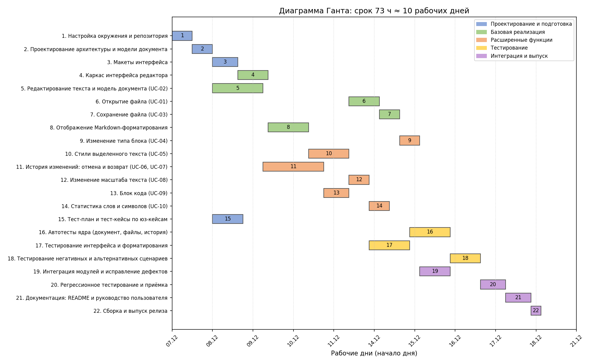

# Проект программного продукта

Командный репозиторий для выбора, оценки и планирования программного продукта.

### Команда

- Болгов Евгений
- Спицин Илья
- Гуров Артём

## Фаза 1: Выбор концепции проекта

### Альтернативные концепции проекта

- Таск-менеджер
- Органайзер изображений
- Менеджер паролей
- Markdown-редактор

### Критерии оценки концепций проекта

- Востребованность
- Простота реализации
- Интерес команды
- Масштабируемость

### Экспертные оценки концепций и критериев

Каждый участник команды независимо оценил важность критериев и соответствие каждой концепции каждому критерию.

**Шкала оценивания:** от 1 до 9.

Для оценки важности критериев:
- 1 — критерий практически неважен;
- 9 — критерий критически важен.

Для оценки концепций:
- 1 — очень плохое соответствие критерию;
- 9 — очень хорошее соответствие критерию.

**Формат оценки:** каждый эксперт по каждой ячейке даёт три значения – пессимистичное, ожидаемое и оптимистичное (упорядочены по возрастанию).

**Результаты экспертного оценивания:** [phase-1/phase-1.xlsx](phase-1/phase-1.xlsx) (листы «Болгов», «Спицин», «Гуров» – индивидуальные оценки экспертов, лист «Сводка» – среднее по трём экспертам).

### Нечёткий коллективный TOPSIS

Оценки экспертов агрегированы по Чену (минимум нижних границ, среднее ожидаемых оценок, максимум верхних границ).
Все критерии «чем больше, тем лучше», поэтому идеал – (1; 1; 1), антиидеал – (0; 0; 0).
Расчёт приведён на листе «TOPSIS» файла [phase-1/phase-1.xlsx](phase-1/phase-1.xlsx).

| Концепция | d⁺ | d⁻ | CC | Место |
|---|---|---|---|---|
| Markdown-редактор | 2,046 | 2,322 | 0,532 | 1 |
| Таск-менеджер | 2,197 | 2,108 | 0,490 | 2 |
| Менеджер паролей | 2,521 | 1,756 | 0,410 | 3 |
| Органайзер изображений | 2,559 | 1,680 | 0,396 | 4 |

### Коллективный МАИ

Парные сравнения получены из ожидаемых оценок экспертов: разность баллов по шкале 1–9 переведена в шкалу Саати.
Суждения трёх экспертов агрегированы геометрическим средним, веса найдены как нормированное среднее геометрическое строк матрицы.
Расчёт приведён на листе «МАИ» файла [phase-1/phase-1.xlsx](phase-1/phase-1.xlsx).

Веса критериев: простота реализации – 0,451; востребованность – 0,267; интерес команды – 0,203; масштабируемость – 0,079.
Отношение согласованности всех матриц не превышает 0,021 (допустимо до 0,1).

| Концепция              | Приоритет | Место |
| ---------------------- | --------- | ----- |
| Markdown-редактор      | 0,431     | 1     |
| Таск-менеджер          | 0,286     | 2     |
| Менеджер паролей       | 0,150     | 3     |
| Органайзер изображений | 0,134     | 4     |

### Выводы по фазе 1

Оба метода дали одинаковый порядок концепций, лучшей признан **Markdown-редактор**.
Его преимущество обеспечили два самых весомых критерия: простота реализации и интерес команды.
Таск-менеджер лидирует по востребованности и масштабируемости, но масштабируемость получила наименьший вес.
В TOPSIS отрыв лидера небольшой (0,532 против 0,490), в МАИ заметно больше (0,431 против 0,286), потому что шкала Саати усиливает разницу в баллах.
Дальнейшая работа (фазы 2–5) ведётся над Markdown-редактором.

## Фаза 2: Распределение работы

Работа фазы 3 разбита на 12 индивидуальных задач и 3 общие (выполняют все участники, в распределении не участвуют).
Трудозатраты задач оценены экспертно, каждый участник поставил оценки предпочтительности задач по шкале 1–9
(1 – совсем не хочется или неудобно, 9 – очень хочется или удобно).
Данные и результат: [phase-2/phase-2.xlsx](phase-2/phase-2.xlsx), решатель: [phase-2/solve.py](phase-2/solve.py).

### Задачи, трудозатраты и предпочтения

| № | Задача | Часы | Болгов | Спицин | Гуров | Исполнитель |
|---|---|---|---|---|---|---|
| 1 | Определить границы проекта, акторов и состав функций | 2 | 6 | 5 | 8 | Гуров |
| 2 | Написать юз-кейсы UC-01–UC-05 (основные сценарии) | 4 | 8 | 5 | 6 | Болгов |
| 3 | Написать юз-кейсы UC-06–UC-10 (основные сценарии) | 4 | 8 | 4 | 6 | Болгов |
| 4 | Описать альтернативные и негативные сценарии | 3 | 5 | 6 | 7 | Гуров |
| 5 | Изучить метод COSMIC | 2 | 4 | 8 | 5 | Спицин |
| 6 | Выделить функциональные процессы и посчитать COSMIC FP | 5 | 3 | 9 | 5 | Спицин |
| 7 | Изучить метод Use Case Points | 1,5 | 4 | 7 | 6 | Спицин |
| 8 | Посчитать UCP и перевести в трудозатраты | 4 | 3 | 8 | 6 | Спицин |
| 9 | Подготовить форму экспертной оценки и агрегировать оценки | 2 | 4 | 8 | 5 | Гуров |
| 10 | Сравнить три оценки и сделать выводы о масштабе проекта | 3 | 5 | 5 | 9 | Гуров |
| 11 | Определить срок выполнения и состав команды | 2 | 5 | 4 | 9 | Гуров |
| 12 | Оформить раздел фазы 3 в README | 3 | 8 | 4 | 5 | Болгов |

Общие задачи (на каждого участника): ревью и согласование юз-кейсов – 1 ч; индивидуальная экспертная оценка трудозатрат юз-кейсов – 1,5 ч; обсуждение расхождений в оценках – 1 ч. Итого 3,5 ч на человека.

### Постановка задачи

Пусть $x_{ij} = 1$, если задачу $i$ выполняет участник $j$, иначе $0$; $p_{ij}$ – предпочтительность задачи $i$ для участника $j$; $h_i$ – трудозатраты задачи $i$ (ч); $H = \sum_i h_i$; $m = 3$ – число участников.

Целевая функция – максимизировать суммарную предпочтительность:

$$\max \sum_{i}\sum_{j} p_{ij}\, x_{ij}$$

Ограничения:

1. Каждую задачу выполняет ровно один участник: $\sum_j x_{ij} = 1$.
2. Нагрузка каждого близка к средней: $\left|\sum_i h_i x_{ij} - H/m\right| \le \Delta$, где $\Delta = 2$ ч.
3. У каждого не меньше $k = 3$ задач: $\sum_i x_{ij} \ge k$.
4. Изучение метода и его применение выполняет один человек: $x_{5j} = x_{6j}$ (COSMIC) и $x_{7j} = x_{8j}$ (UCP) для всех $j$.
5. $x_{ij} \in \{0, 1\}$.

Обоснование: предпочтения максимизируются, чтобы каждый делал то, что ему ближе, это повышает мотивацию и качество работы. Допуск по нагрузке защищает от перегрузки одного участника. Минимум задач не даёт отдать человеку одну крупную задачу. Связанные задачи объединены, чтобы знания о методе не передавались между людьми.

### Результат

Задача решена как целочисленная линейная (scipy, решатель HiGHS). Суммарная предпочтительность: 94.

| Участник | Задачи | Задач | Нагрузка, ч | С общими задачами, ч | Сумма предпочтений |
|---|---|---|---|---|---|
| Болгов | 2, 3, 12 | 3 | 11,0 | 14,5 | 24 |
| Спицин | 5, 6, 7, 8 | 4 | 12,5 | 16,0 | 32 |
| Гуров | 1, 4, 9, 10, 11 | 5 | 12,0 | 15,5 | 38 |

Средняя нагрузка по индивидуальным задачам – 11,83 ч, наибольшее отклонение – 0,83 ч, что укладывается в допуск 2 ч. Все ограничения выполнены.

### Чувствительность к допуску по нагрузке

| Допуск Δ, ч | Суммарная предпочтительность | Нагрузка Болгов / Спицин / Гуров, ч | Разброс нагрузки, ч |
|---|---|---|---|
| 1 | 94 | 11,0 / 12,5 / 12,0 | 1,5 |
| 2 | 94 | 11,0 / 12,5 / 12,0 | 1,5 |
| 3 | 97 | 11,0 / 14,5 / 10,0 | 4,5 |
| 5 | 97 | 11,0 / 14,5 / 10,0 | 4,5 |
| без ограничения | 97 | 11,0 / 14,5 / 10,0 | 4,5 |

### Выводы по фазе 2

Оптимальное распределение закрепляет за каждым участником задачи, которые ему ближе: Болгов пишет юз-кейсы и оформляет документацию, Спицин выполняет оба расчёта (COSMIC и UCP), Гуров занимается постановкой границ, сценариями и выводами.
При допуске 3 ч и более ограничение на нагрузку перестаёт влиять на решение: предпочтительность максимальна (97), но нагрузка распределена неравномерно (разброс 4,5 ч). Сужение допуска до 2 ч снижает целевую функцию на 3 пункта (около 3 %) и сокращает разброс нагрузки втрое, до 1,5 ч, поэтому мы приняли $\Delta = 2$ ч.
Распределение переносится в [матрицу RACI](raci-matrix.md): исполнитель каждой задачи получает роль R/A.

## Фаза 3: Оценка проекта

Варианты использования (10 штук, с альтернативными и негативными сценариями): [phase-3/use-cases.md](phase-3/use-cases.md).
Расчёты: [phase-3/phase-3.xlsx](phase-3/phase-3.xlsx) (листы «COSMIC», «UCP», «Экспертная оценка», «Итоги»).

### Оценка в COSMIC Function Points

Граница измерения – приложение; внешние акторы – пользователь и локальная файловая система.
Выделено 13 функциональных процессов, каждое перемещение данных (Entry, Exit, Read, Write) даёт 1 CFP.
Сообщения об ошибках и статусах считаются одним Exit на процесс.

| UC | CFP |
|---|---|
| UC-01 Открытие файла | 6 |
| UC-02 Изменение текста | 9 |
| UC-03 Сохранение | 4 |
| UC-04 Тип блока | 10 |
| UC-05 Стили | 7 |
| UC-06 Отмена | 6 |
| UC-07 Возврат | 6 |
| UC-08 Масштаб | 5 |
| UC-09 Блок кода | 5 |
| UC-10 Статистика | 6 |
| **Итого** | **64** |

При допущении 5 ч на 1 CFP трудозатраты составляют **320 ч**.

### Оценка в Use Case Points

- Акторы: пользователь (сложный, 3) и файловая система (простой, 1): UAW = 4.
- Варианты использования: 6 средних (по 10) и 4 простых (по 5): UUCW = 80.
- UUCP = 84, технический фактор TCF = 0,80, фактор окружения ECF = 0,995.
- **UCP = 84 × 0,80 × 0,995 ≈ 66,9.**

При 20 ч на 1 UCP трудозатраты составляют **≈ 1337 ч**.

### Экспертная оценка

Каждый эксперт оценил каждый вариант использования тремя значениями (оптимистичная, вероятная, пессимистичная).
Оценка по PERT: (О + 4В + П) / 6, затем среднее по трём экспертам и сумма по вариантам использования.
Сумма по вариантам использования – 116,7 ч, плюс 30 % на общие работы вне вариантов использования
(архитектура, окружение, интеграция, тесты, документация): **≈ 152 ч**.

### Выводы по фазе 3

| Метод | Размер | Трудозатраты, ч | Срок при 60 ч в неделю на команду, недель |
|---|---|---|---|
| Экспертная оценка | 10 UC | 152 | 2,5 |
| COSMIC | 64 CFP | 320 | 5,3 |
| Use Case Points | 66,9 UCP | 1337 | 22,3 |

Проект небольшой: 10 вариантов использования средней и малой сложности, один основной актор, одна внешняя система.
Оценки различаются в разы. Эксперты оценивали работу с учётом наших условий и выбранного стека,
а коэффициенты 5 ч/CFP и 20 ч/UCP – общие допущения, не подкреплённые нашей статистикой.
UCP-оценка рассчитана на промышленную разработку и для небольшого учебного проекта завышена, поэтому служит верхней границей.

Для планирования принимаем экспертную оценку как базовую, а COSMIC как проверку сверху:
рабочий диапазон **150–320 ч**, то есть примерно 2,5–5,5 недель командой из трёх человек.
Команды из трёх человек достаточно: проект не требует узкой специализации, нужны разработка интерфейса, работа с файлами и тестирование.

Управление рамками (что можно отбросить при дефиците времени):
- UC-08 (Изменение масштаба текста) — вторичная фича для MVP, можно временно зафиксировать размер шрифта.
- UC-10 (Просмотр количества слов и символов) — полезная, но не влияющая на ключевой функционал редактора статистика.

## Фаза 4: Прогнозирование

Мы прогнозируем срок выполнения работ фазы 5 (планирования проекта) методом Монте-Карло в двух постановках.
Данные и результаты: [phase-4/phase-4.xlsx](phase-4/phase-4.xlsx), симуляция: [phase-4/simulation.py](phase-4/simulation.py).

### Работы фазы 5 и трёхточечные оценки

Оценки даны в человеко-часах всей команды: О – оптимистичная, В – вероятная, П – пессимистичная, PERT = (О + 4В + П) / 6.

| № | Задача | О, ч | В, ч | П, ч | PERT, ч |
|---|---|---|---|---|---|
| 1 | Декомпозиция проекта на задачи | 2,0 | 3,0 | 5,0 | 3,2 |
| 2 | Определение состава команды и специальностей | 0,5 | 1,0 | 2,0 | 1,1 |
| 3 | Назначение ресурсных требований задач | 1,0 | 2,0 | 3,0 | 2,0 |
| 4 | Построение связей предшествования | 1,0 | 2,0 | 4,0 | 2,2 |
| 5 | Подготовка кода расписания | 3,0 | 5,0 | 9,0 | 5,3 |
| 6 | Запуск эвристик и выбор лучшего решения | 1,0 | 2,0 | 4,0 | 2,2 |
| 7 | Перенос расписания на 8-часовой график | 1,0 | 2,0 | 3,0 | 2,0 |
| 8 | Обсуждение и согласование плана (встреча) | 1,5 | 3,0 | 6,0 | 3,2 |
| 9 | Оформление отчёта по фазе 5 | 2,0 | 3,0 | 5,0 | 3,2 |
| | **Итого** | 13,0 | 23,0 | 41,0 | **24,3** |

### История прошлых недель

Статистика взята из матрицы RACI (фазы 1–3): задача считается выполненной в неделю даты окончания, часы распределены равномерно по дням срока задачи.

| Неделя (понедельник) | Выполнено задач | Часов на предмет |
|---|---|---|
| 07.09.2026 | 1 | 3,8 |
| 14.09.2026 | 2 | 4,9 |
| 21.09.2026 | 1 | 4,4 |
| 28.09.2026 | 1 | 4,5 |
| 05.10.2026 | 2 | 5,2 |
| 12.10.2026 | 3 | 6,8 |
| 19.10.2026 | 6 | 16,5 |
| 26.10.2026 | 7 | 25,0 |
| 02.11.2026 | 3 | 6,5 |
| **Среднее** | **2,9** | **8,6** |

### Модели

**Модель 1 (по числу задач).** История недель рассматривается как дискретное распределение числа выполненных задач. На каждой неделе симуляции число выполненных задач берётся из него случайно; недели считаются, пока не выполнены все 9 задач фазы 5.

**Модель 2 (по трудозатратам).** Часы, которые команда уделяет предмету в неделю, берутся случайно из истории (дискретное распределение). Трудозатраты каждой задачи на каждом запуске берутся из треугольного распределения с параметрами (О, В, П). Недели считаются, пока накопленные часы не покроют суммарные трудозатраты.

Каждая модель запускалась 100 000 раз (seed 42). Срок с достоверностью 80 % – наименьшее число недель, которого достаточно в 80 % запусков.

### Результаты

| Модель | Среднее, недель | Медиана | **80 %** | 90 % | Минимум | Максимум |
|---|---|---|---|---|---|---|
| Модель 1: по числу задач | 3,69 | 3 | **5** | 5 | 2 | 9 |
| Модель 2: по трудозатратам | 3,77 | 4 | **5** | 6 | 1 | 8 |

Суммарные трудозатраты фазы 5 в модели 2: в среднем 25,7 ч, с достоверностью 80 % – 27,4 ч.

Вероятность уложиться в заданное число недель:

| Недель | Модель 1 | Модель 2 |
|---|---|---|
| не более 1 | 0,0% | 4,2% |
| не более 2 | 19,6% | 22,4% |
| не более 3 | 50,3% | 46,6% |
| не более 4 | 73,1% | 65,1% |
| не более 5 | 90,2% | 86,3% |

### Сравнение моделей и выводы

Результаты двух моделей получились близкими: срок с достоверностью 80 % одинаков и равен 5 неделям, средний срок отличается на 0,08 недели (3,69 и 3,77). Заметное различие только в «хвосте»: в модели 2 вероятность того, что потребуется 6 и более недель, выше (13,7 % против 9,8 %).

Возможные объяснения:

1. Обе модели опираются на одну и ту же историю, а число задач и часов в неделю в ней тесно связаны. Средняя задача в истории занимала около 3,0 ч (77,5 ч на 26 задач), а средняя задача фазы 5 – около 2,9 ч (25,7 ч на 9 задач). Поэтому считать задачи и считать часы почти одно и то же.
2. Модель 2 дополнительно учитывает неопределённость самих задач: треугольное распределение со смещением к пессимистичной оценке даёт среднюю работу 25,7 ч при PERT 24,3 ч, а разброс недельных часов (от 3,8 до 25 ч) добавляет изменчивости. Отсюда более тяжёлый хвост.
3. История короткая (9 недель), и в ней есть и спокойные недели (4–5 ч), и недели перед сдачей (16–25 ч). Симуляция считает недели независимыми и равновероятными, поэтому оценка довольно широкая.

Вывод: на работы фазы 5 нужно ожидать 3–4 недели, а с достоверностью 80 % не более 5 недель. Плановый срок в матрице RACI (10.11–04.12.2026, около 3,6 недели) укладывается в этот прогноз.

## Фаза 5: Планирование

Планируем реализацию Markdown-редактора (проект из фаз 1 и 3) с ограниченными ресурсами.
Данные и результаты: [phase-5/phase-5.xlsx](phase-5/phase-5.xlsx), расчёт: [phase-5/schedule.py](phase-5/schedule.py), диаграмма: [phase-5/gantt.png](phase-5/gantt.png).

### Состав команды и ресурсы

По выводам фазы 3 проекту не нужна узкая специализация, но удобно разделить работу на три направления. Команда из трёх человек, по одному на специальность:

| Специальность | Людей | Загрузка, ч |
|---|---|---|
| Frontend (Ф) – интерфейс, отображение, стили | 1 | 53 |
| Backend (Б) – модель документа, файлы, история | 1 | 57 |
| Тестировщик (Т) – тесты, документация | 1 | 38 |

Суммарные трудозатраты проекта – 148 чел.-ч, что близко к экспертной оценке фазы 3 (около 152 ч).

### Задачи, ресурсы и предшествование

Длительность – в рабочих часах; Ф, Б, Т – занятые специальности (по одному человеку на задачу).

| № | Задача | Длит., ч | Ресурсы | Предшественники | Начало | Окончание |
|---|---|---|---|---|---|---|
| 1 | Настройка окружения и репозитория | 4 | Ф+Б | – | 07.12.2026 | 07.12.2026 |
| 2 | Проектирование архитектуры и модели документа | 4 | Ф+Б | 1 | 07.12.2026 | 07.12.2026 |
| 3 | Макеты интерфейса | 5 | Ф | 1 | 08.12.2026 | 08.12.2026 |
| 4 | Каркас интерфейса редактора | 6 | Ф | 2, 3 | 08.12.2026 | 09.12.2026 |
| 5 | Редактирование текста и модель документа (UC-02) | 10 | Б | 2 | 08.12.2026 | 09.12.2026 |
| 6 | Открытие файла (UC-01) | 6 | Б | 4, 5 | 11.12.2026 | 14.12.2026 |
| 7 | Сохранение файла (UC-03) | 4 | Б | 6 | 14.12.2026 | 14.12.2026 |
| 8 | Отображение Markdown-форматирования | 8 | Ф | 4, 5 | 09.12.2026 | 10.12.2026 |
| 9 | Изменение типа блока (UC-04) | 4 | Ф+Б | 5, 8 | 14.12.2026 | 15.12.2026 |
| 10 | Стили выделенного текста (UC-05) | 8 | Ф | 8 | 10.12.2026 | 11.12.2026 |
| 11 | История изменений: отмена и возврат (UC-06, UC-07) | 12 | Б | 5 | 09.12.2026 | 10.12.2026 |
| 12 | Изменение масштаба текста (UC-08) | 4 | Ф | 4 | 11.12.2026 | 11.12.2026 |
| 13 | Блок кода (UC-09) | 5 | Б | 5, 8 | 10.12.2026 | 11.12.2026 |
| 14 | Статистика слов и символов (UC-10) | 4 | Ф | 5 | 11.12.2026 | 14.12.2026 |
| 15 | Тест-план и тест-кейсы по юз-кейсам | 6 | Т | 2 | 08.12.2026 | 08.12.2026 |
| 16 | Автотесты ядра (документ, файлы, история) | 8 | Т | 7, 11 | 14.12.2026 | 15.12.2026 |
| 17 | Тестирование интерфейса и форматирования | 8 | Т | 10, 12, 13 | 11.12.2026 | 14.12.2026 |
| 18 | Тестирование негативных и альтернативных сценариев | 6 | Т | 15, 16 | 15.12.2026 | 16.12.2026 |
| 19 | Интеграция модулей и исправление дефектов | 6 | Ф+Б | 9, 10, 11, 12, 13, 14 | 15.12.2026 | 15.12.2026 |
| 20 | Регрессионное тестирование и приёмка | 5 | Т | 17, 18, 19 | 16.12.2026 | 17.12.2026 |
| 21 | Документация: README и руководство пользователя | 5 | Т | 19 | 17.12.2026 | 17.12.2026 |
| 22 | Сборка и выпуск релиза | 2 | Б | 20, 21 | 17.12.2026 | 18.12.2026 |

### Метод

Расписание строится последовательной схемой: из задач, у которых выполнены все предшественники, выбирается задача с наивысшим приоритетом и ставится в самое раннее время, когда хватает ресурсов. Перебраны все 12 правил приоритета из задания (SLK, FREE, LST, LFT, LSTLFT, GRPW, LPT, MIS, GRD, GRWC, GCRWC, ROT) и 5000 случайных порядков (seed 42). Итоговое решение – лучшее из всех.

| Правило | Срок проекта, ч |
|---|---|
| SLK | 74 |
| FREE | 75 |
| LST | 74 |
| LFT | 75 |
| LSTLFT | 75 |
| GRPW | **73** |
| LPT | 84 |
| MIS | 79 |
| GRD | 83 |
| GRWC | 79 |
| GCRWC | 83 |
| ROT | 88 |
| Лучший из 5000 случайных | **73** |

Лучший срок – 73 ч дали правило GRPW и случайный порядок. Для сравнения: критический путь без учёта ресурсов – 51 ч, нижняя оценка по загрузке самой загруженной специальности (Backend) – 57 ч. Среднее по случайным порядкам – 81,4 ч, лучшего срока достигли лишь 0,3 % из них, поэтому перебор правил оказался полезнее случайного поиска. Дополнительно оптимальность проверена точным методом (целочисленное программирование на временной сетке, [phase-5/exact_check.py](phase-5/exact_check.py)): оптимум тоже 73 ч, то есть эвристика нашла лучшее возможное решение.

### Расписание

Расписание переведено на обычный график: 8 часов в день, 5 дней в неделю (40 часов), старт в понедельник 07.12.2026, праздники не учитывались. Проверка в Excel подтверждает, что ресурсы ни в один час не превышены и все связи предшествования соблюдены.

| Этап | Начало | Окончание | Рабочих дней |
|---|---|---|---|
| Проектирование и подготовка | 07.12.2026 | 08.12.2026 | 2 |
| Базовая реализация | 08.12.2026 | 14.12.2026 | 5 |
| Расширенные функции | 09.12.2026 | 15.12.2026 | 5 |
| Тестирование | 11.12.2026 | 16.12.2026 | 4 |
| Интеграция и выпуск | 15.12.2026 | 18.12.2026 | 4 |
| **Проект в целом** | **07.12.2026** | **18.12.2026** | **10** |

Этапы пересекаются: задачи разных этапов идут параллельно, пока позволяют зависимости и ресурсы.

### Выводы по фазе 5

Проект выполним за 73 рабочих часа, то есть за 10 рабочих дней (2 недели): с 07.12.2026 по 18.12.2026. При полной занятости трёх человек общая загрузка составила бы 148 чел.-ч, а срок определяют два фактора: зависимости между задачами и самая загруженная специальность (Backend, 57 ч). Тестировщик загружен меньше всех (38 ч), и на его простое в начале проекта и в конце можно было бы сэкономить, например подключив его к документации и подготовке тестовых данных заранее.
Оценка срока фазы 3 (около 2,5 недель) делалась в предположении 20 ч работы в неделю на человека, здесь по заданию принят 8-часовой рабочий день, поэтому срок получился короче в календарном выражении.